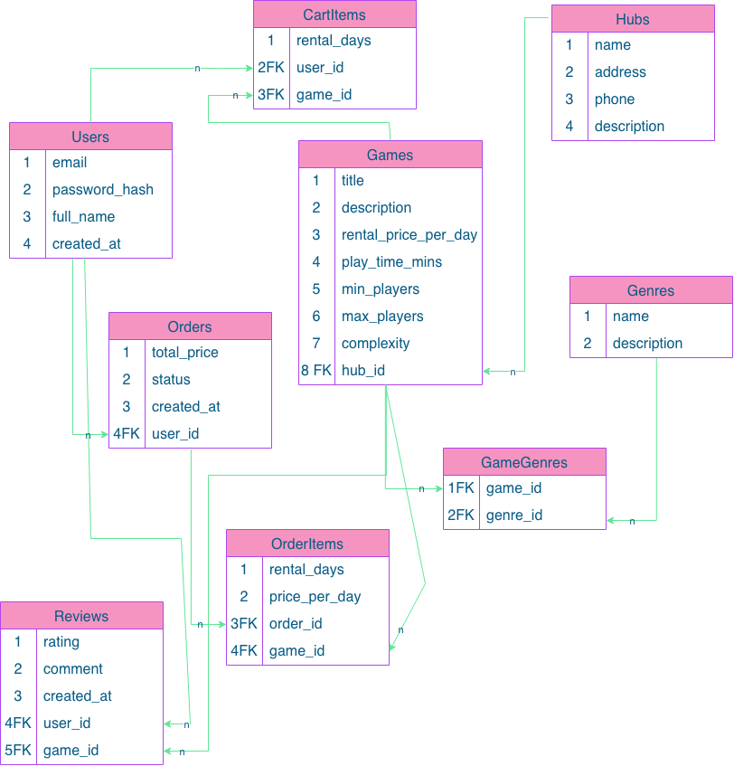

# BoardGame Platform

## Опис проєкту
**BoardGame Hub** — це вебплатформа для любителів настільних ігор, яка об'єднує каталог ігор, відгуки та можливість оренди ігор додому або бронювання ігрових сесій у локальних хабах та клубах настільних ігор.

Застосунок дозволяє користувачам шукати ігри за різними параметрами (кількість гравців, тривалість, складність), читати відгуки, переглядати сторінки жанрів і хабів. Авторизовані користувачі можуть залишати відгуки, додавати ігри до кошика оренди та створювати замовлення на бронювання.


## REST API Endpoints

Усі дані передаються у форматі JSON.

### 1. Настільні ігри (Games)
* **`GET /api/v1/games`**
  * **Використання:** Отримання переліку ігор із фільтрацією, пошуком та сортуванням.
  * **Request method:** `GET`
  * **Query parameters:**
    * `search` (string) — пошук за назвою
    * `hub_id` (integer) — фільтр за хабом
    * `genre_id` (integer) — фільтр за жанром
    * `min_players` (integer) — мінімальна кількість гравців
    * `complexity` (string) — складність (`Easy`, `Medium`, `Hard`)
    * `sort` (string) — сортування (`price_asc`, `price_desc`, `rating_desc`, `rating_asc`, `popularity`)
  * **Request body:** немає
  * **Response status:** `200 OK`
  * **Response body:**
    ```json
    {
      "count": 12,
      "results": [
        {
          "id": 1,
          "title": "Catan",
          "rental_price_per_day": 150.0,
          "rating": 4.8,
          "min_players": 3,
          "max_players": 4,
          "complexity": "Medium",
          "hub": { "id": 10, "name": "Dice & Roll Kyiv" }
        }
      ]
    }
    ```

* **`GET /api/v1/games/{id}`**
  * **Використання:** Отримання детальної інформації про конкретну гру.
  * **Request method:** `GET`
  * **Request body:** немає
  * **Response status:** `200 OK` / `404 Not Found`
  * **Response body:**
    ```json
    {
      "id": 1,
      "title": "Catan",
      "description": "Класична містобудівна стратегія про освоєння острова...",
      "rental_price_per_day": 150.0,
      "play_time_mins": 90,
      "min_players": 3,
      "max_players": 4,
      "complexity": "Medium",
      "rating": 4.8,
      "hub": { "id": 10, "name": "Dice & Roll Kyiv" },
      "genres": [{ "id": 5, "name": "Стратегії" }]
    }
    ```

* **`POST /api/v1/games`**
  * **Використання:** Додавання нової гри в каталог (для адміністраторів/хабів).
  * **Request method:** `POST`
  * **Request body:**
    ```json
    {
      "title": "Catan",
      "description": "Класична містобудівна стратегія...",
      "rental_price_per_day": 150.0,
      "play_time_mins": 90,
      "min_players": 3,
      "max_players": 4,
      "complexity": "Medium",
      "hub_id": 10,
      "genre_ids": [5]
    }
    ```
  * **Response status:** `201 Created`
  * **Response body:**
    ```json
    {
      "id": 1,
      "title": "Catan",
      "status": "created"
    }
    ```

* **`PUT /api/v1/games/{id}`**
  * **Використання:** Повне оновлення даних гри.
  * **Request method:** `PUT`
  * **Request body:**
    ```json
    {
      "title": "Catan (Updated)",
      "description": "Оновлений опис...",
      "rental_price_per_day": 160.0,
      "play_time_mins": 90,
      "min_players": 3,
      "max_players": 4,
      "complexity": "Medium",
      "hub_id": 10,
      "genre_ids": [5]
    }
    ```
  * **Response status:** `200 OK`

* **`DELETE /api/v1/games/{id}`**
  * **Використання:** Видалення гри з каталогу.
  * **Request method:** `DELETE`
  * **Request body:** немає
  * **Response status:** `204 No Content`

---

### 2. Жанри та Категорії (Genres)
* **`GET /api/v1/genres`**
  * **Використання:** Отримання списку всіх жанрів.
  * **Request method:** `GET`
  * **Request body:** немає
  * **Response status:** `200 OK`
  * **Response body:**
    ```json
    [
      { "id": 5, "name": "Стратегії", "description": "Ігри на планування та розвиток" },
      { "id": 6, "name": "Кооперативні", "description": "Командна гра проти ігрового поля" }
    ]
    ```

* **`POST /api/v1/genres`**
  * **Використання:** Створення нового жанру.
  * **Request method:** `POST`
  * **Request body:**
    ```json
    {
      "name": "Стратегії",
      "description": "Ігри на планування та розвиток"
    }
    ```
  * **Response status:** `201 Created`
  * **Response body:**
    ```json
    {
      "id": 5,
      "name": "Стратегії",
      "description": "Ігри на планування та розвиток"
    }
    ```

* **`GET /api/v1/genres/{id}/games`**
  * **Використання:** Отримання всіх ігор обраного жанру.
  * **Request method:** `GET`
  * **Request body:** немає
  * **Response status:** `200 OK`
  * **Response body:**
    ```json
    {
      "genre_id": 5,
      "genre_name": "Стратегії",
      "games": [
        { "id": 1, "title": "Catan", "rating": 4.8 }
      ]
    }
    ```

---

### 3. Ігрові Хаби та Клуби (Hubs)
* **`GET /api/v1/hubs`**
  * **Використання:** Отримання списку локальних хабів.
  * **Request method:** `GET`
  * **Request body:** немає
  * **Response status:** `200 OK`
  * **Response body:**
    ```json
    [
      { "id": 10, "name": "Dice & Roll Kyiv", "address": "вул. Хрещатик, 1", "phone": "+380441234567" }
    ]
    ```

* **`POST /api/v1/hubs`**
  * **Використання:** Створення нового хабу.
  * **Request method:** `POST`
  * **Request body:**
    ```json
    {
      "name": "Dice & Roll Kyiv",
      "address": "вул. Хрещатик, 1",
      "phone": "+380441234567",
      "description": "Хаб у центрі Києва"
    }
    ```
  * **Response status:** `201 Created`
  * **Response body:**
    ```json
    {
      "id": 10,
      "name": "Dice & Roll Kyiv",
      "address": "вул. Хрещатик, 1",
      "phone": "+380441234567",
      "description": "Хаб у центрі Києва"
    }
    ```

* **`GET /api/v1/hubs/{id}/games`**
  * **Використання:** Отримання всіх ігор, наявних у конкретному хабі.
  * **Request method:** `GET`
  * **Request body:** немає
  * **Response status:** `200 OK`
  * **Response body:**
    ```json
    {
      "hub_id": 10,
      "hub_name": "Dice & Roll Kyiv",
      "games": [
        { "id": 1, "title": "Catan", "rental_price_per_day": 150.0 }
      ]
    }
    ```

---

### 4. Відгуки (Reviews)
* **`GET /api/v1/games/{id}/reviews`**
  * **Використання:** Перегляд усіх відгуків для конкретної гри.
  * **Request method:** `GET`
  * **Request body:** немає
  * **Response status:** `200 OK`
  * **Response body:**
    ```json
    [
      {
        "id": 101,
        "user_name": "Олексій",
        "rating": 5,
        "comment": "Чудова гра для компанії!",
        "created_at": "2026-10-10T12:00:00Z"
      }
    ]
    ```

* **`POST /api/v1/games/{id}/reviews`**
  * **Використання:** Додавання відгуку та оцінки авторизованим користувачем.
  * **Request method:** `POST`
  * **Request body:**
    ```json
    {
      "rating": 5,
      "comment": "Чудова гра для компанії!"
    }
    ```
  * **Response status:** `201 Created`

---

### 5. Кошик та Замовлення (Cart & Orders)
* **`GET /api/v1/cart`**
  * **Використання:** Перегляд поточного кошика оренди користувача.
  * **Request method:** `GET`
  * **Request body:** немає
  * **Response status:** `200 OK`
  * **Response body:**
    ```json
    {
      "items": [
        {
          "cart_item_id": 1,
          "game": { "id": 1, "title": "Catan", "rental_price_per_day": 150.0 },
          "rental_days": 3,
          "item_total": 450.0
        }
      ],
      "total_price": 450.0
    }
    ```

* **`POST /api/v1/cart/items`**
  * **Використання:** Додавання гри до кошика.
  * **Request method:** `POST`
  * **Request body:**
    ```json
    {
      "game_id": 1,
      "rental_days": 3
    }
    ```
  * **Response status:** `201 Created`

* **`DELETE /api/v1/cart/items/{id}`**
  * **Використання:** Видалення товару з кошика.
  * **Request method:** `DELETE`
  * **Request body:** немає
  * **Response status:** `204 No Content`

* **`POST /api/v1/orders`**
  * **Використання:** Оформлення замовлення/оренди (конвертує всі товари з кошика в замовлення).
  * **Request method:** `POST`
  * **Request body:** немає *(TODO: за потреби додати поле для коментаря або адреси доставки)*
  * **Response status:** `201 Created`
  * **Response body:**
    ```json
    {
      "order_id": 101,
      "status": "confirmed",
      "total_price": 450.0,
      "created_at": "2026-10-13T15:00:00Z"
    }
    ```

* **`GET /api/v1/orders`**
  * **Використання:** Перегляд історії замовлень поточного користувача.
  * **Request method:** `GET`
  * **Request body:** немає
  * **Response status:** `200 OK`
  * **Response body:**
    ```json
    [
      {
        "order_id": 101,
        "status": "confirmed",
        "total_price": 450.0,
        "created_at": "2026-10-13T15:00:00Z",
        "items": [
          { "game_title": "Catan", "rental_days": 3, "price_per_day": 150.0 }
        ]
      }
    ]
    ```

---

### 6. Авторизація та Профіль (Auth & Profile - TBD)
* **`POST /api/v1/auth/register`**
  * **Використання:** Реєстрація нового користувача.
  * **Request method:** `POST`
  * **Request body:**
    ```json
    {
      "email": "user@example.com",
      "password": "strongpassword123",
      "full_name": "Іван Іванов"
    }
    ```
  * **Response status:** `201 Created`

* **`POST /api/v1/auth/login`** 
  * **Використання:** Вхід користувача та отримання токена/сесії.
  * **Request method:** `POST`
  * **Request body:**
    ```json
    {
      "email": "user@example.com",
      "password": "strongpassword123"
    }
    ```
  * **Response status:** `200 OK`

* **`GET /api/v1/users/me`**
  * **Використання:** Отримання даних профілю поточного користувача.
  * **Request method:** `GET`
  * **Response status:** `200 OK`

---

## Схема бази даних (Database Schema)



### Опис таблиць та зв'язків:
1. **`Users`**: `id`, `email`, `password_hash`, `full_name`, `created_at`
2. **`Hubs`**: `id`, `name`, `address`, `phone`, `description`
3. **`Genres`**: `id`, `name`, `description`
4. **`Games`**: `id`, `title`, `description`, `rental_price_per_day`, `play_time_mins`, `min_players`, `max_players`, `complexity`, `hub_id` *(FK -> Hubs)*
5. **`GameGenres`**: `game_id` *(FK -> Games)*, `genre_id` *(FK -> Genres)* — *(зв'язок M:N)*
6. **`Reviews`**: `id`, `user_id` *(FK -> Users)*, `game_id` *(FK -> Games)*, `rating`, `comment`, `created_at`
7. **`CartItems`**: `id`, `user_id` *(FK -> Users)*, `game_id` *(FK -> Games)*, `rental_days`
8. **`Orders`**: `id`, `user_id` *(FK -> Users)*, `total_price`, `status`, `created_at`
9. **`OrderItems`**: `id`, `order_id` *(FK -> Orders)*, `game_id` *(FK -> Games)*, `rental_days`, `price_per_day`