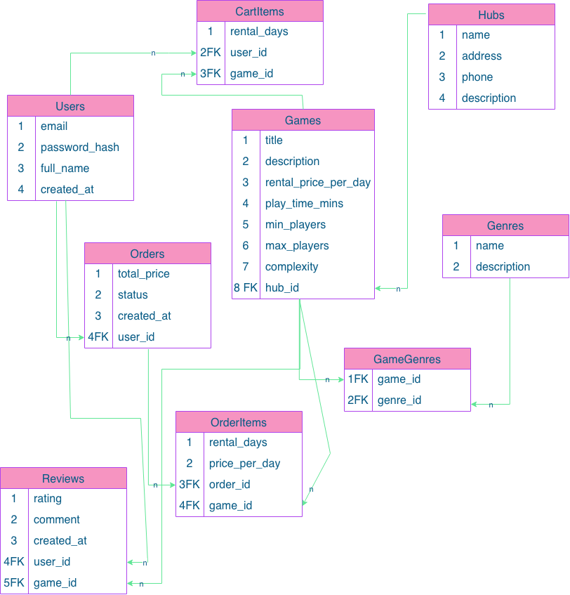

# BoardGame Platform

## Опис проєкту
**BoardGame Hub** — це вебплатформа для любителів настільних ігор, яка об'єднує каталог ігор, відгуки та можливість оренди ігор додому або бронювання ігрових сесій у локальних хабах та клубах настільних ігор.

Застосунок дозволяє користувачам шукати ігри за різними параметрами (кількість гравців, тривалість, складність), читати відгуки, переглядати сторінки жанрів і хабів. Авторизовані користувачі можуть залишати відгуки, додавати ігри до кошика оренди та створювати замовлення на бронювання.

## Як запустити проєкт

### 1. Клонування репозиторію

```bash
git clone <repo-url>
cd <папка-проєкту>
```

### 2. Віртуальне середовище

```bash
python3 -m venv .venv
source .venv/bin/activate        # macOS / Linux
# .venv\Scripts\activate         # Windows
```

### 3. Залежності

```bash
pip install -r requirements.txt
```

Для перевірки форматування коду:

```bash
pip install -r requirements-dev.txt
```

### 4. Міграції та тестові дані

```bash
python3 manage.py migrate
```

Міграція `0003_add_data` автоматично додає:

- 2 хаби
- 3 жанри
- 5 ігор

Міграція `users.0002_create_profiles` створює `Profile` для наявних користувачів.
Для нових користувачів профіль створюється автоматично під час реєстрації.

### 5. Запуск сервера

```bash
python3 manage.py runserver
```

- API: http://127.0.0.1:8000/api/v1/
- Адмінка: http://127.0.0.1:8000/admin/

Для доступу до адмінки можна створити суперкористувача:

```bash
python3 manage.py createsuperuser
```

Суперюзер автоматично отримує роль `admin`. Перевірити або змінити роль:
`/admin/` → **Users → Profiles**.

### 6. Перевірка

```bash
python3 check_submission.py
```

### 7. Postman

Імпортуйте колекцію `postman/boardgame_api.postman_collection.json`. Базова адреса сервера вже винесена у змінну `{{base_url}}`.

## REST API Endpoints

Усі дані передаються у форматі JSON.

> **Статус реалізації:** реалізовано Games, Genres, Hubs, Auth & Profile і CORS.
> Reviews, Cart & Orders — заплановано.

### Автентифікація та ролі

API використовує JWT. Після логіну клієнт отримує пару токенів:

| Токен | Час життя | Призначення |
|---|---|---|
| `access` | 5 хвилин | додається до кожного захищеного запиту |
| `refresh` | 1 доба | отримання нового `access` без повторного логіну |

Заголовок для захищених запитів:

```http
Authorization: Bearer <access>
```

Ролі користувачів:

| Роль | Де зберігається | Права |
|---|---|---|
| `user` | `Profile.role` | читати каталог, переглядати власний профіль |
| `admin` | `Profile.role` | усе, що `user`, + створювати/редагувати/видаляти хаби, жанри, ігри |

`is_staff` (доступ до Django admin) **не** дає прав на запис у каталог — перевіряється саме `Profile.role`.

> Суперюзер автоматично отримує `role="admin"` (сигнал `post_save`).
> Змінити роль можна в адмінці: **Users → Profiles**.

Правила доступу:

| Endpoint | Метод | Доступ |
|---|---|---|
| `/games`, `/genres`, `/hubs`, їхні `{id}` та `/{id}/games` | `GET` | публічно |
| `/games`, `/genres`, `/hubs` | `POST`, `PUT`, `DELETE` | лише `admin` |
| `/register`, `/token`, `/token/refresh` | `POST` | публічно |
| `/users/me` | `GET` | будь-який автентифікований |

Усі помилки мають однаковий формат:

```json
{
  "error": {
    "message": "Невалідні дані.",
    "details": {
      "email": ["Введіть коректну email-адресу."]
    }
  }
}
```

`details` — порожній об'єкт (`{}`), якщо помилка не стосується конкретних полів.

| Код | Коли виникає |
|---|---|
| `400` | невалідні дані; у `details` — повідомлення по кожному полю |
| `401` | немає токена; токен битий або прострочений; невірний логін |
| `403` | токен валідний, але роль не `admin` |
| `404` | об'єкта не існує |
| `405` | метод не підтримується |
| `409` | хаб або жанр має пов'язані ігри |

### 1. Настільні ігри (Games)
* **`GET /api/v1/games`**
  * **Використання:** Отримання переліку ігор із фільтрацією, пошуком та сортуванням.
  * **Request method:** `GET`
  * **Query parameters:**
    * `search` (string) — пошук за назвою
    * `hub_id` (integer) — фільтр за хабом
    * `genre_id` (integer) — фільтр за жанром
    * `min_players` (integer) — мінімальна кількість гравців
    * `complexity` (string) — складність (`Easy`, `Medium`, `Hard`)
    * `sort` (string) — сортування (`price_asc`, `price_desc`, `rating_desc`, `rating_asc`, `popularity`)
  * **Request body:** немає
  * **Response status:** `200 OK`
  * **Response body:**
    ```json
    {
      "count": 12,
      "results": [
        {
          "id": 1,
          "title": "Catan",
          "rental_price_per_day": 150.0,
          "rating": 4.8,
          "min_players": 3,
          "max_players": 4,
          "complexity": "Medium",
          "hub": { "id": 10, "name": "Dice & Roll Kyiv" }
        }
      ]
    }
    ```

* **`GET /api/v1/games/{id}`**
  * **Використання:** Отримання детальної інформації про конкретну гру.
  * **Request method:** `GET`
  * **Request body:** немає
  * **Response status:** `200 OK` / `404 Not Found`
  * **Response body:**
    ```json
    {
      "id": 1,
      "title": "Catan",
      "description": "Класична містобудівна стратегія про освоєння острова...",
      "rental_price_per_day": 150.0,
      "play_time_mins": 90,
      "min_players": 3,
      "max_players": 4,
      "complexity": "Medium",
      "rating": 4.8,
      "hub": { "id": 10, "name": "Dice & Roll Kyiv" },
      "genres": [{ "id": 5, "name": "Стратегії" }]
    }
    ```

* **`POST /api/v1/games`**
  * **Використання:** Додавання нової гри в каталог (лише адміністратор).
  * **Request method:** `POST`
  * **Request body:**
    ```json
    {
      "title": "Catan",
      "description": "Класична містобудівна стратегія...",
      "rental_price_per_day": 150.0,
      "play_time_mins": 90,
      "min_players": 3,
      "max_players": 4,
      "complexity": "Medium",
      "hub_id": 10,
      "genre_ids": [5]
    }
    ```
  * **Response status:** `201 Created`
  * **Response body:**
    ```json
    {
      "id": 1,
      "title": "Catan",
      "status": "created"
    }
    ```

* **`PUT /api/v1/games/{id}`**
  * **Використання:** Повне оновлення даних гри.
  * **Request method:** `PUT`
  * **Request body:**
    ```json
    {
      "title": "Catan (Updated)",
      "description": "Оновлений опис...",
      "rental_price_per_day": 160.0,
      "play_time_mins": 90,
      "min_players": 3,
      "max_players": 4,
      "complexity": "Medium",
      "hub_id": 10,
      "genre_ids": [5]
    }
    ```
  * **Response status:** `200 OK`

* **`DELETE /api/v1/games/{id}`**
  * **Використання:** Видалення гри з каталогу.
  * **Request method:** `DELETE`
  * **Request body:** немає
  * **Response status:** `204 No Content`

---

### 2. Жанри та Категорії (Genres)
* **`GET /api/v1/genres`**
  * **Використання:** Отримання списку всіх жанрів.
  * **Request method:** `GET`
  * **Request body:** немає
  * **Response status:** `200 OK`
  * **Response body:**
    ```json
    [
      { "id": 5, "name": "Стратегії", "description": "Ігри на планування та розвиток" },
      { "id": 6, "name": "Кооперативні", "description": "Командна гра проти ігрового поля" }
    ]
    ```

* **`POST /api/v1/genres`**
  * **Використання:** Створення нового жанру.
  * **Request method:** `POST`
  * **Request body:**
    ```json
    {
      "name": "Стратегії",
      "description": "Ігри на планування та розвиток"
    }
    ```
  * **Response status:** `201 Created`
  * **Response body:**
    ```json
    {
      "id": 5,
      "name": "Стратегії",
      "description": "Ігри на планування та розвиток"
    }
    ```

* **`GET /api/v1/genres/{id}/games`**
  * **Використання:** Отримання всіх ігор обраного жанру.
  * **Request method:** `GET`
  * **Request body:** немає
  * **Response status:** `200 OK`
  * **Response body:**
    ```json
    {
      "genre_id": 5,
      "genre_name": "Стратегії",
      "games": [
        { "id": 1, "title": "Catan", "rating": 4.8 }
      ]
    }
    ```

---

### 3. Ігрові Хаби та Клуби (Hubs)
* **`GET /api/v1/hubs`**
  * **Використання:** Отримання списку локальних хабів.
  * **Request method:** `GET`
  * **Request body:** немає
  * **Response status:** `200 OK`
  * **Response body:**
    ```json
    [
      { "id": 10, "name": "Dice & Roll Kyiv", "address": "вул. Хрещатик, 1", "phone": "+380441234567" }
    ]
    ```

* **`POST /api/v1/hubs`**
  * **Використання:** Створення нового хабу.
  * **Request method:** `POST`
  * **Request body:**
    ```json
    {
      "name": "Dice & Roll Kyiv",
      "address": "вул. Хрещатик, 1",
      "phone": "+380441234567",
      "description": "Хаб у центрі Києва"
    }
    ```
  * **Response status:** `201 Created`
  * **Response body:**
    ```json
    {
      "id": 10,
      "name": "Dice & Roll Kyiv",
      "address": "вул. Хрещатик, 1",
      "phone": "+380441234567",
      "description": "Хаб у центрі Києва"
    }
    ```

* **`GET /api/v1/hubs/{id}/games`**
  * **Використання:** Отримання всіх ігор, наявних у конкретному хабі.
  * **Request method:** `GET`
  * **Request body:** немає
  * **Response status:** `200 OK`
  * **Response body:**
    ```json
    {
      "hub_id": 10,
      "hub_name": "Dice & Roll Kyiv",
      "games": [
        { "id": 1, "title": "Catan", "rental_price_per_day": 150.0 }
      ]
    }
    ```

---

### 4. Відгуки (Reviews) — planned

> Статус: заплановано, у поточній версії не реалізовано.

* **`GET /api/v1/games/{id}/reviews`**
  * **Використання:** Перегляд усіх відгуків для конкретної гри.
  * **Request method:** `GET`
  * **Request body:** немає
  * **Response status:** `200 OK`
  * **Response body:**
    ```json
    [
      {
        "id": 101,
        "user_name": "Олексій",
        "rating": 5,
        "comment": "Чудова гра для компанії!",
        "created_at": "2026-10-10T12:00:00Z"
      }
    ]
    ```

* **`POST /api/v1/games/{id}/reviews`**
  * **Використання:** Додавання відгуку та оцінки авторизованим користувачем.
  * **Request method:** `POST`
  * **Request body:**
    ```json
    {
      "rating": 5,
      "comment": "Чудова гра для компанії!"
    }
    ```
  * **Response status:** `201 Created`

---

### 5. Кошик та Замовлення (Cart & Orders) — planned

> Статус: заплановано, у поточній версії не реалізовано.

* **`GET /api/v1/cart`**
  * **Використання:** Перегляд поточного кошика оренди користувача.
  * **Request method:** `GET`
  * **Request body:** немає
  * **Response status:** `200 OK`
  * **Response body:**
    ```json
    {
      "items": [
        {
          "cart_item_id": 1,
          "game": { "id": 1, "title": "Catan", "rental_price_per_day": 150.0 },
          "rental_days": 3,
          "item_total": 450.0
        }
      ],
      "total_price": 450.0
    }
    ```

* **`POST /api/v1/cart/items`**
  * **Використання:** Додавання гри до кошика.
  * **Request method:** `POST`
  * **Request body:**
    ```json
    {
      "game_id": 1,
      "rental_days": 3
    }
    ```
  * **Response status:** `201 Created`

* **`DELETE /api/v1/cart/items/{id}`**
  * **Використання:** Видалення товару з кошика.
  * **Request method:** `DELETE`
  * **Request body:** немає
  * **Response status:** `204 No Content`

* **`POST /api/v1/orders`**
  * **Використання:** Оформлення замовлення/оренди (конвертує всі товари з кошика в замовлення).
  * **Request method:** `POST`
  * **Request body:** немає *(TODO: за потреби додати поле для коментаря або адреси доставки)*
  * **Response status:** `201 Created`
  * **Response body:**
    ```json
    {
      "order_id": 101,
      "status": "confirmed",
      "total_price": 450.0,
      "created_at": "2026-10-13T15:00:00Z"
    }
    ```

* **`GET /api/v1/orders`**
  * **Використання:** Перегляд історії замовлень поточного користувача.
  * **Request method:** `GET`
  * **Request body:** немає
  * **Response status:** `200 OK`
  * **Response body:**
    ```json
    [
      {
        "order_id": 101,
        "status": "confirmed",
        "total_price": 450.0,
        "created_at": "2026-10-13T15:00:00Z",
        "items": [
          { "game_title": "Catan", "rental_days": 3, "price_per_day": 150.0 }
        ]
      }
    ]
    ```

---

### 6. Авторизація та Профіль (Auth & Profile)

> Реалізовано

#### `POST /api/v1/register`

Реєстрація нового користувача. Доступ: публічний.

Request body:

```json
{
  "username": "alina",
  "first_name": "Аліна",
  "last_name": "Іваненко",
  "email": "alina@example.com",
  "password": "StrongPass1",
  "password_confirmation": "StrongPass1"
}
```

Правила валідації:

| Поле | Обов'язкове | Правила |
|---|---|---|
| `username` | так | до 150 символів, унікальний |
| `first_name` | ні | до 150 символів |
| `last_name` | ні | до 150 символів |
| `email` | так | коректний email, до 254 символів, унікальний без урахування регістру |
| `password` | так | 8–128 символів, велика й мала літери, цифра |
| `password_confirmation` | так | має збігатися з `password` |

Response `201 Created`:

```json
{
  "id": 1,
  "username": "alina",
  "first_name": "Аліна",
  "last_name": "Іваненко",
  "email": "alina@example.com",
  "role": "user"
}
```

Приклад помилки `400 Bad Request`:

```json
{
  "error": {
    "message": "Невалідні дані.",
    "details": {
      "username": ["Користувач з таким username вже існує."],
      "password": ["Пароль має містити хоча б одну велику літеру."]
    }
  }
}
```

Пароль зберігається у вигляді хешу. `Profile` із роллю `user` створюється автоматично.

#### `POST /api/v1/token`

Логін. Доступ: публічний.

Request body:

```json
{
  "username": "alina",
  "password": "StrongPass1"
}
```

Response `200 OK`:

```json
{
  "access": "eyJhbGciOi...",
  "refresh": "eyJhbGciOi..."
}
```

Помилка `401 Unauthorized`:

```json
{
  "error": {
    "message": "Невірний username або пароль.",
    "details": {}
  }
}
```

#### `POST /api/v1/token/refresh`

Отримання нового `access` за `refresh`. Доступ: публічний.

Request body:

```json
{
  "refresh": "eyJhbGciOi..."
}
```

Response `200 OK`:

```json
{
  "access": "eyJhbGciOi..."
}
```

Якщо `refresh` прострочений, битий або це `access`-токен:

```json
{
  "error": {
    "message": "Токен недійсний або прострочений. Увійдіть повторно.",
    "details": {}
  }
}
```

#### `GET /api/v1/users/me`

Дані поточного користувача. Доступ: будь-який автентифікований.

Request headers:

```http
Authorization: Bearer <access>
```

Response `200 OK`:

```json
{
  "id": 1,
  "username": "alina",
  "first_name": "Аліна",
  "last_name": "Іваненко",
  "email": "alina@example.com",
  "role": "admin"
}
```

Без токена — `401 Unauthorized`:

```json
{
  "error": {
    "message": "Потрібна автентифікація. Передайте access-токен у заголовку Authorization.",
    "details": {}
  }
}
```

#### Вихід (logout)

Окремого ендпоінта немає. Клієнт видаляє `access` і `refresh` зі свого сховища
(`localStorage` / `sessionStorage`). Після цього токени не використовуються.

---

## Схема бази даних (Database Schema)



### Опис таблиць та зв'язків:

1. **`Users`**: `id`, `username`, `password` (хеш), `first_name`, `last_name`, `email`, `is_staff`, `is_superuser`, `is_active`, `date_joined`, `role` (`user` / `admin`)
2. **`Hubs`**: `id`, `name`, `address`, `phone`, `description`
3. **`Genres`**: `id`, `name` (unique), `description`
4. **`Games`**: `id`, `title`, `description`, `rental_price_per_day`, `play_time_mins`, `min_players`, `max_players`, `complexity`, `rating`, `hub_id` *(FK -> Hubs)*
5. **`GameGenres`**: `game_id` *(FK -> Games)*, `genre_id` *(FK -> Genres)* — *(зв'язок M:N)*
6. **`Reviews`**: `id`, `user_id` *(FK -> Users)*, `game_id` *(FK -> Games)*, `rating`, `comment`, `created_at`
7. **`CartItems`**: `id`, `user_id` *(FK -> Users)*, `game_id` *(FK -> Games)*, `rental_days`
8. **`Orders`**: `id`, `user_id` *(FK -> Users)*, `total_price`, `status`, `created_at`
9. **`OrderItems`**: `id`, `order_id` *(FK -> Orders)*, `game_id` *(FK -> Games)*, `rental_days`, `price_per_day`

> Фактичні назви таблиць у БД: `Users` → `auth_user` + `users_profile` (роль зберігається окремо), `Hubs` → `catalog_hub`, `Genres` → `catalog_genre`, `Games` → `catalog_game`, `GameGenres` → `catalog_game_genres`.
> `Reviews`, `CartItems`, `Orders`, `OrderItems` — заплановані, у поточній версії таблиць ще немає.
> `db_schema.png` ілюструє початковий дизайн; актуальна схема — в міграціях (`catalog/migrations`, `users/migrations`).